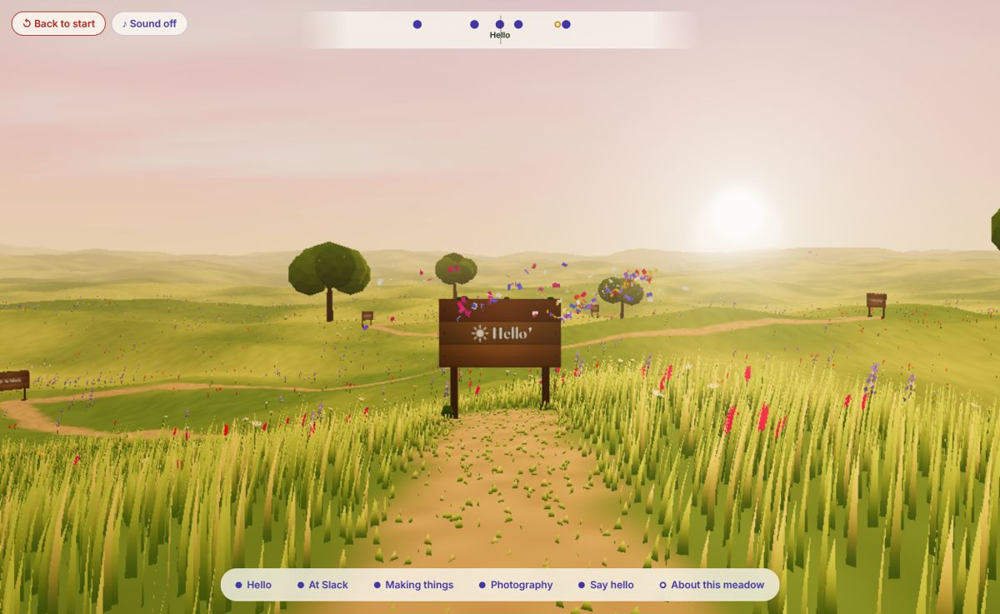

# Anirudh Janga

A one-page site you explore: a Flower-like valley of rolling hills under a warm,
painted sky, grown in three.js. You arrive on a rise, drift through the grass as the
wind, and read my story on wooden boards standing in the meadow.

**Live: [anirudh-janga.github.io/anirudh](https://anirudh-janga.github.io/anirudh/)**

## Getting around

- **Click or tap the grass** to drift there; **drag** to look; **W/A/S/D** or arrows to glide.
- **Click a board** (or pick one from the trail at the bottom) to go and read it.
- **Keyboard:** Tab through the boards (each drifts you towards it), Enter to read, Esc to close.
- **Read everything as a page:** the first Tab stop switches to a plain readable page.

## What's in the meadow

Everything is procedural (no texture or audio files):

- endless rolling hills, a painted sky, lone trees on the crests
- a sea of grass that follows you, with wind waves rolling over the hills
- six wooden boards: Hello, At Slack, Making things, Photography, Say hello, About this meadow
- a petal stream (the wind made visible) that shows the way to the next board
- buds that bloom around each board you read, and colour that spreads back into the
  dusky valley until, with every board read, it's golden hour
- optional ambient sound (off by default): wind, a warm pad, a chime per bloom

## Layout

    index.html              the content (each section becomes a board's reading card)
    src/main.js             tiny entry: grows the meadow after first paint, adapts quality
    src/explore.js          gliding, boards, reading cards, compass, trail
    src/sound.js            opt-in Web Audio ambience
    src/meadow/             terrain, sky, grass, flowers, boards, petals, bloom, post
    docs/STORIES.md         the plan, story by story (Part 1: M1–M6, Part 2: F1–F8)
    docs/RESEARCH.md        where every fact on the page comes from
    docs/review/            screenshots and checks

`?quality=0.1…1` overrides the automatic quality.

## Run it

    npm install
    npm run dev

Every push to `main` builds and deploys to GitHub Pages via `.github/workflows/deploy.yml`.
