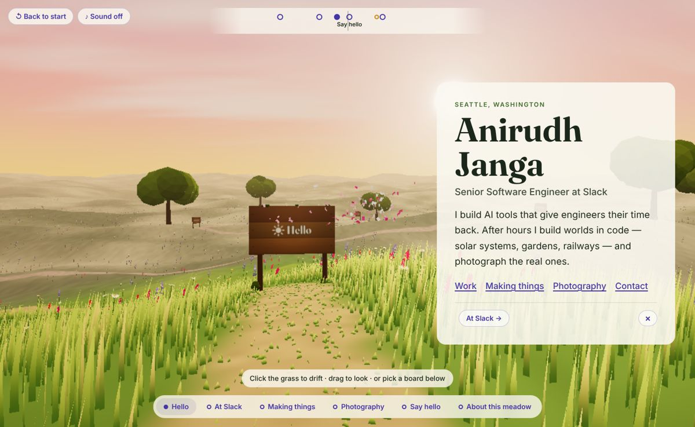
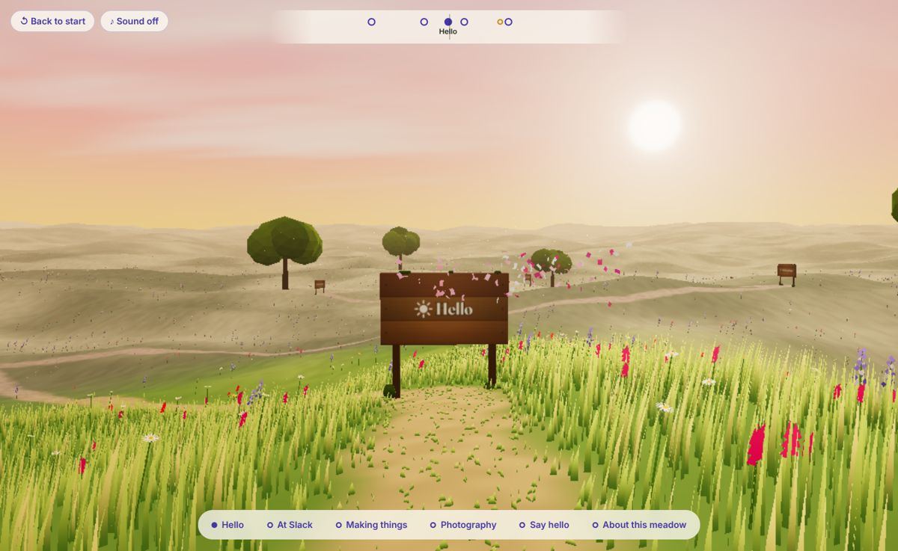
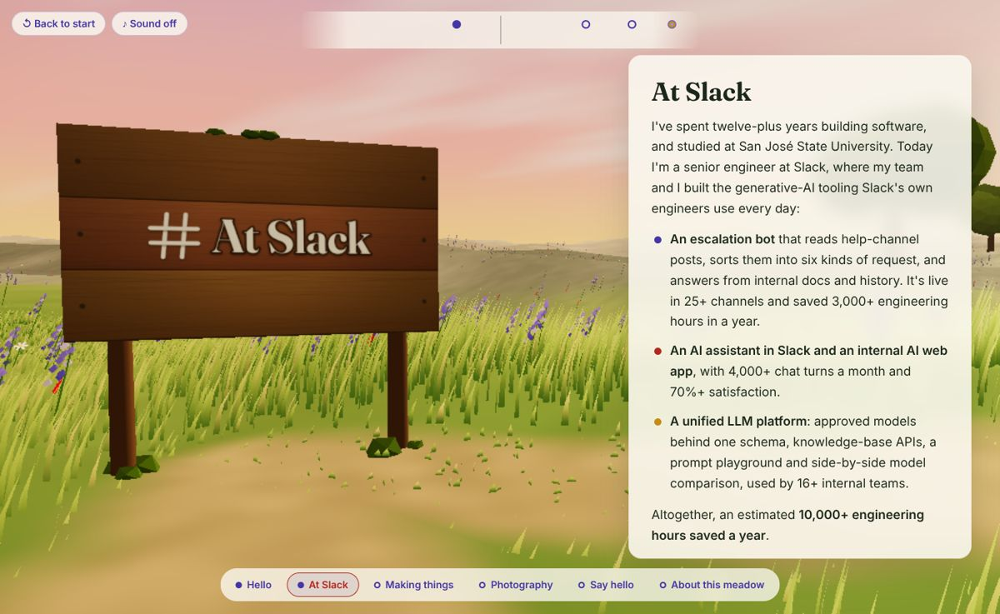
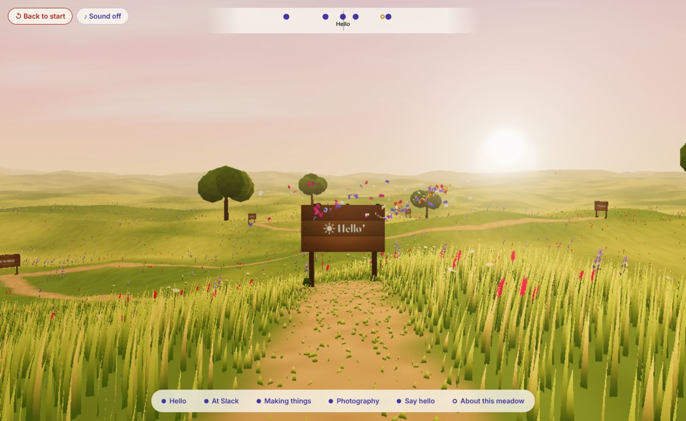
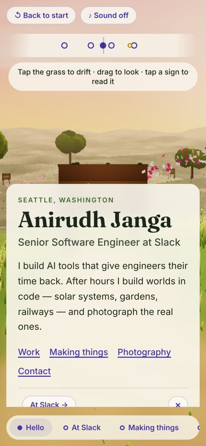
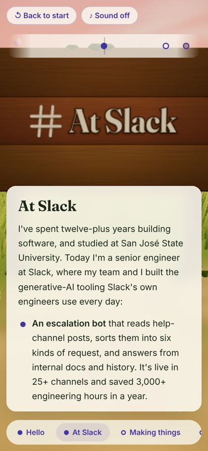
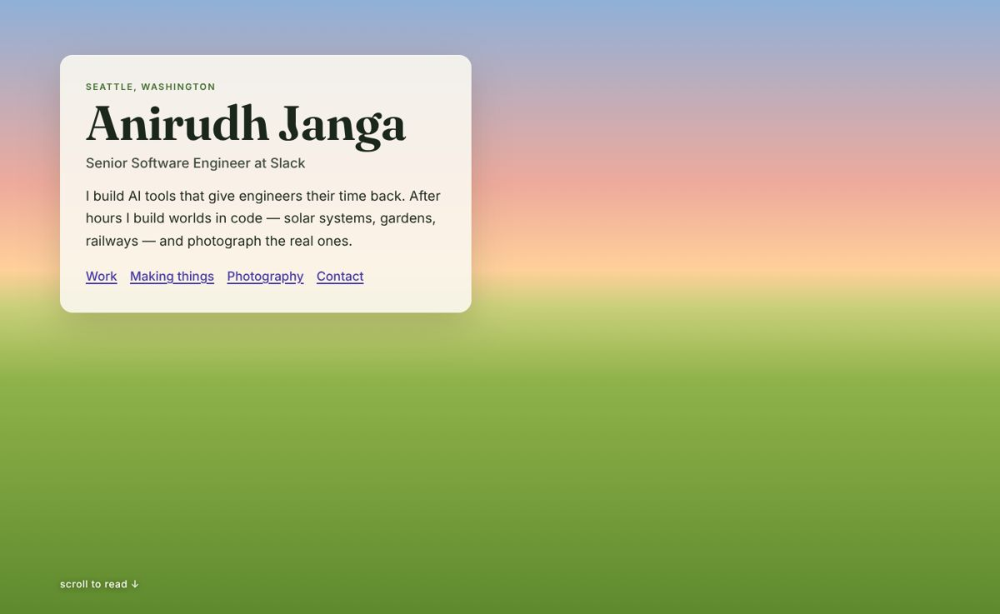

# Review — Part 2 (Story F8)

Screenshots of the explorable meadow, taken in headless Chromium with a software
renderer at reduced quality (`?quality=0.25–0.45`). On a real GPU the grass and
flowers are denser and everything moves.

| | |
|---|---|
| **The start:** you arrive on the rise, the Hello board ahead, its card open. The valley is still dusky.  | **Gliding:** drifting towards a board, the petal stream swirling around you.  |
| **Reading:** At Slack, with violet lupines blooming around the board.  | **All five read:** the whole valley in colour at golden hour.  |

| phone: start | phone: reading | no WebGL |
|---|---|---|
|  |  |  |

## Content check against RESEARCH.md

The text on the boards is the same confirmed content as in Part 1 (see the table in
git history for M6); nothing new was claimed. Contact links use the renamed GitHub
account, `anirudh-janga`.

## Checks run

- `npm run build`: passes
- axe-core (WCAG 2 A/AA + best practice): **0 violations**, with the Hello card
  open, with the At Slack card open, and in "read as a page" mode
- Keyboard: Tab goes Read everything as a page → Hello → At Slack → Making things →
  Photography → Say hello → About this meadow → Back to start → Sound. Tab onto a
  board drifts towards it, Enter opens it, Esc closes it and returns focus without
  moving you
- "Read everything as a page" switches to the plain page and back
- Sound: off by default; turning it on builds the pad, opening a board plays its chime
- No WebGL: no canvas; the full page renders on the warm gradient
- Console: no errors across the start, gliding, every board, golden hour, the phone and the fallback
